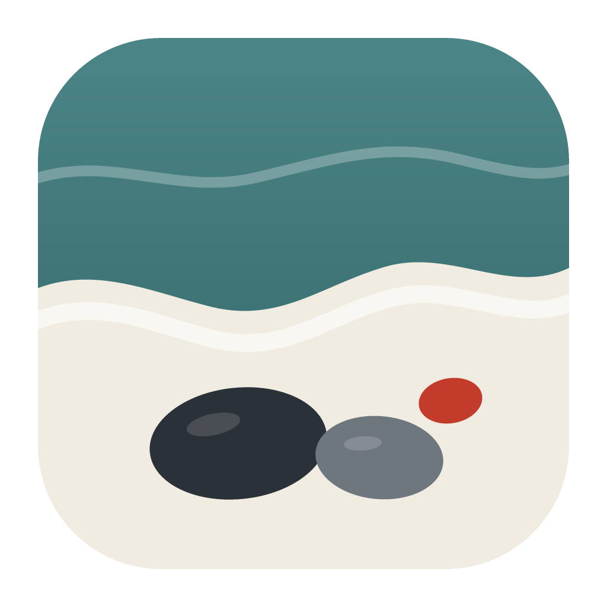
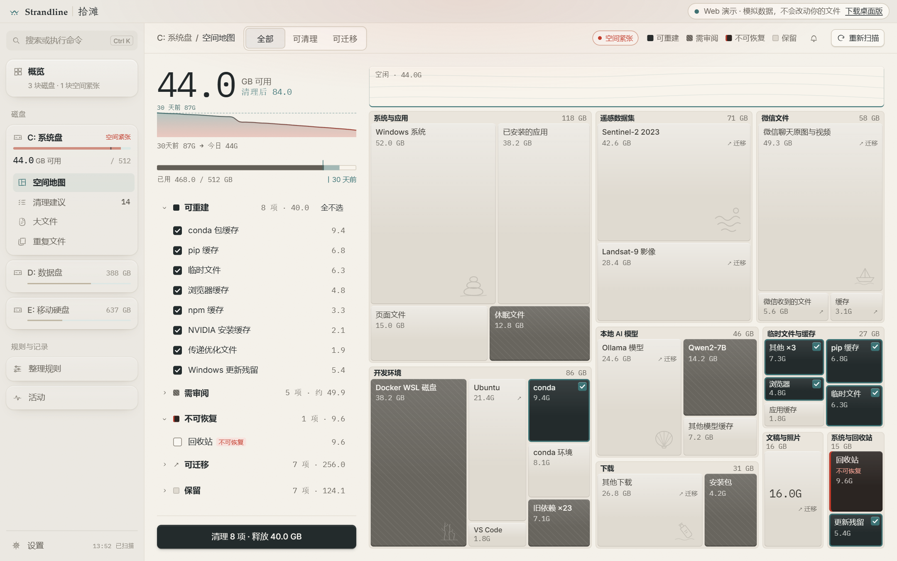
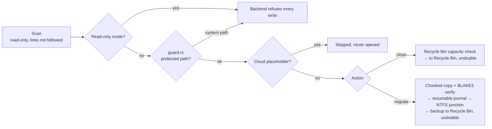
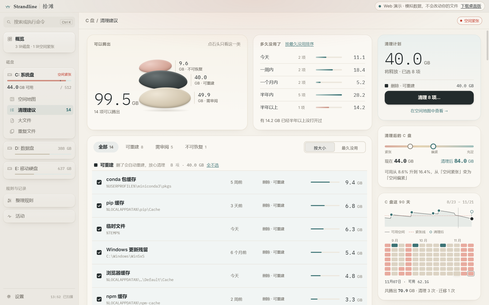
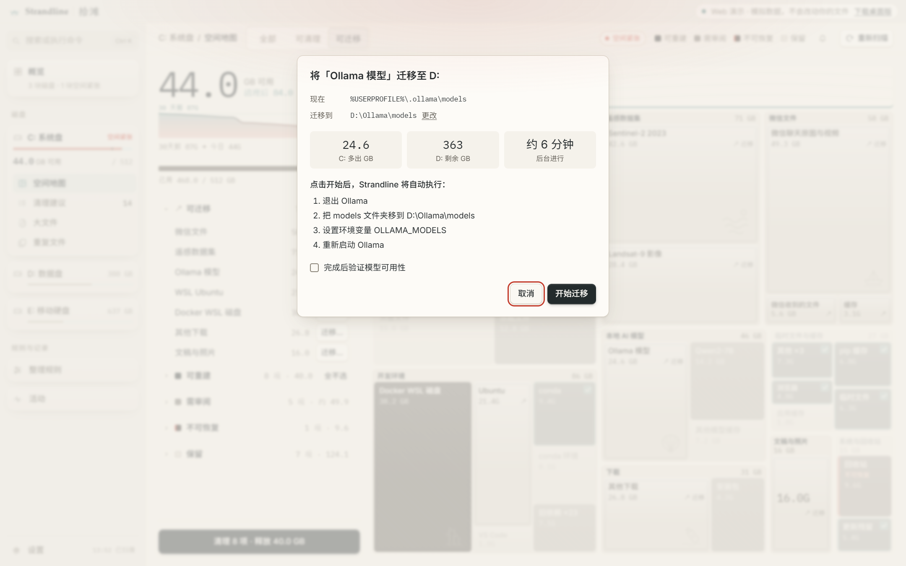
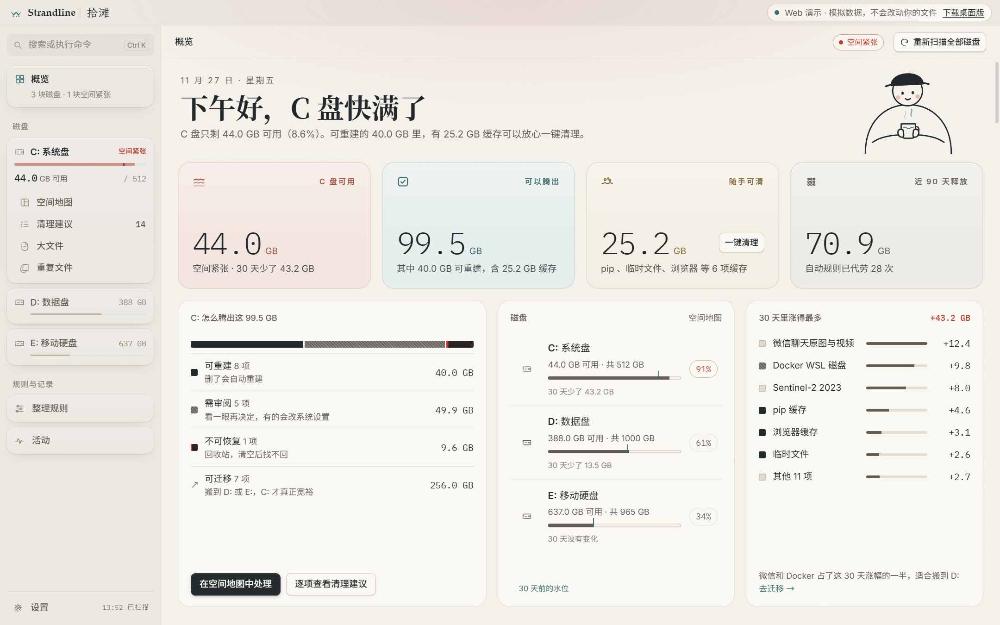
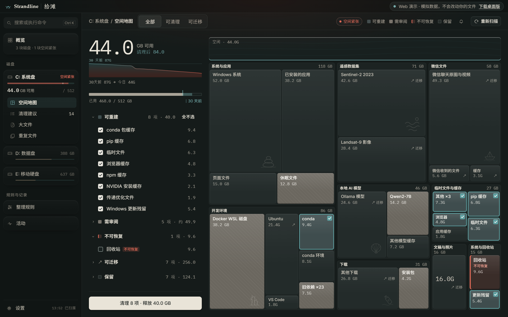
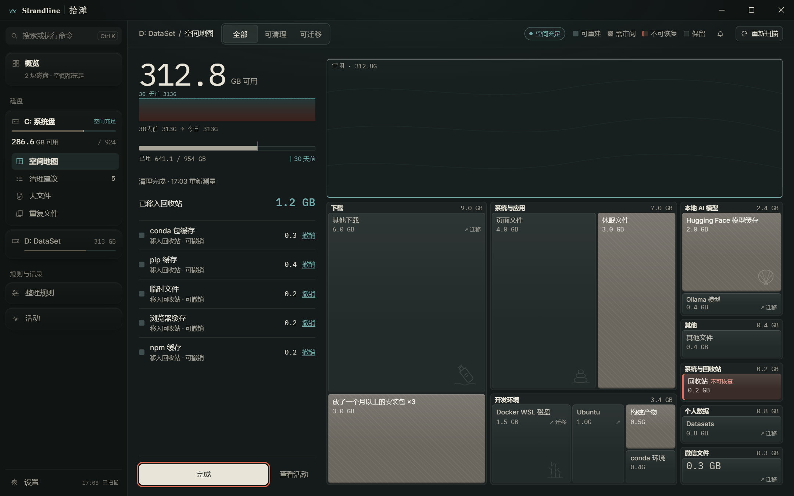

<p align="center"></p>

<h1 align="center">Strandline · 拾滩</h1>

<p align="center">
  <b>A safety-first disk-space map and seamless folder migration tool for Windows</b><br>
  See what is actually using your drive, then decide what to clean and what to move. Read-only by default, Recycle Bin only, and moved folders keep working at their old path.
</p>

<p align="center">
  <a href="https://qua-drant.github.io/strandline/"></a>
  <a href="https://github.com/Qua-Drant/strandline/actions/workflows/ci.yml"></a>
  <a href="https://github.com/Qua-Drant/strandline/releases"></a>
  
  
  
  <a href="LICENSE"></a>
</p>

<p align="center"><a href="README.md">简体中文</a> · <b>English</b> · <a href="SECURITY.md">Security model</a></p>

> The interface is in Simplified Chinese.

<p align="center">
  
  <br><sub>Space map · <b>Web demo · mock data</b></sub>
</p>

## Why

When C: is nearly full, most disk tools show either a treemap cut up by folder or a "clean 12 GB now" button. What people actually want to know is:

- **Whose space is this?** A path like `AppData\Local\...` doesn't say whether it is WeChat, Docker or model weights.
- **What happens if I delete it?** Caches rebuild and installers can be downloaded again; projects and chat history can't.
- **Can I move it instead?** Many big folders (WeChat files, WSL disks, Ollama models) are simply on the wrong drive.

How Strandline answers:

| Concern | What the interface does |
| --- | --- |
| Can't read the space usage | The map groups blocks by **purpose** (system, dev tools, AI models, caches, personal files…) and draws free space as a **true-proportion** band instead of a percentage |
| Is it safe to delete? | Blocks are coloured by how safe they are to clean; every suggestion says what it is, what deleting it means, and the equivalent PowerShell |
| Fear of mistakes | Read-only by default; everything goes to the Recycle Bin with one-click undo for 30 days; system paths are refused in the backend and no setting can widen that |
| Deleting doesn't free much | *Migrate* moves a whole folder to another drive and leaves a directory junction behind, so programs don't notice |
| When did the space disappear? | A 90-day "tide calendar" records free space every day, next to the activity history |

## Five layers of protection



1. **Read-only by default** — first launch only scans; clean, recycle, migrate and rules are refused by the Rust backend until you switch it off in *Settings › 清理与安全*.
2. **Recycle Bin as the safety net** — nothing is deleted outright. Before recycling, the volume's Recycle Bin size limit and "delete immediately" setting are checked; anything Windows would silently destroy is refused and explained.
3. **System and cloud files are never touched** — `src-tauri/src/guard.rs` hard-codes Windows, Program Files, boot/recovery folders, page files, registry hives and more, checked again after resolving links. OneDrive / iCloud online-only placeholders are never opened, counted, hashed or migrated.
4. **BLAKE3 verification and resume** — migration copies in chunks, reads every file back and compares hashes, keeps a journal and resumes after interruption; it pauses while the owning app runs or a file is held open.
5. **Seamless migration with NTFS junctions** — once verified, the original folder is renamed to a backup and a junction is created in its place (rolled back if unreachable); the backup goes to the Recycle Bin and the whole migration can be undone.

Details: [SECURITY.md](SECURITY.md).

## Screenshots

| | |
| --- | --- |
| <br><sub>Suggestions + 90-day tide calendar · <b>Web demo · mock data</b></sub> | <br><sub>Moving Ollama models to D: · <b>Web demo · mock data</b></sub> |
| <br><sub>Overview · <b>Web demo · mock data</b></sub> | <br><sub>Space map (dark) · <b>Web demo · mock data</b></sub> |

<p align="center">
  
  <br><sub>Cleanup receipt: 1.2 GB to the Recycle Bin, 5 undoable items · <b>Desktop app · sandbox run</b> (scanning the fake drive from <code>npm run sandbox</code>)</sub>
</p>

## Get started in 30 seconds

**1. Open the live demo** (no install, all data is mock — click anything): <https://qua-drant.github.io/strandline/>

**2. Run the demo locally** (Node 22+):

```powershell
npm install
npm run dev        # http://localhost:5173, runs in the browser with mock data
```

**3. Scan your real drive with the desktop app** — download the installer from [Releases](https://github.com/Qua-Drant/strandline/releases) (Windows 10/11, no admin rights needed). It starts read-only, so scanning C: is safe.

Want to try cleaning and migration without touching real files? Use the sandbox:

```powershell
npm run sandbox    # fake drive tree in sandbox\demo (big files are sparse: almost no disk space)
npm run desktop    # needs Rust (stable-msvc) + VS C++ build tools
```

Then set *Settings › 扫描 › 扫描范围* to the full path of `sandbox\demo` and turn read-only mode off. Scans, cleaning, undo and migration then only happen inside that folder.

## Stack and numbers

| | |
| --- | --- |
| Desktop | Tauri v2 + Rust (parallel read-only scan, BLAKE3, `trash`, Win32 file attributes and junctions) |
| Frontend | React 19 + Vite + TypeScript, one interface shared by the desktop app and the web demo |
| Dual mode | A `DiskService` interface: `MockDiskService` in the browser, `TauriDiskService` calling Rust commands on desktop |
| Installer | 2–3 MB (NSIS 2.1 MB / MSI 3.1 MB), uses the system WebView2 |
| Scan speed | 300k files / 3,100 folders in a sandbox: 5.4–7.4 s across runs, ~37 MB peak working set; the map sent to the UI is ~17 KB (release build, `tests/perf.rs`) |
| Tests | 26 Rust tests (21 unit + 1 full sandbox flow + 4 Windows edge cases) + 1 benchmark; 2 frontend tests; clippy warnings fail the build |

Covered by tests: sandbox generation; scanning and cancel; junction loops, hard links, cloud placeholders, unreadable folders; classification without double counting; large files; duplicates (same size, different content is not a duplicate); Recycle Bin recycle and restore; emptying the bin refused in a sandbox; migration verify + junction, resume after interruption, pause while the app runs, undo; rule dry run / run / undo; protected paths. **Every test runs inside `sandbox/.tests` — nothing is ever written to a real system drive.**

## Development

Requirements: Node 22+, Rust (stable-msvc), Visual Studio C++ build tools, WebView2 runtime.

```powershell
npm run lint           # frontend (oxlint)
npm test               # frontend tests
npm run build          # type check + web demo build (dist\)
npm run lint:backend   # cargo clippy, warnings are errors
npm run test:backend   # Rust unit + integration tests, sandbox only
cargo test --release --manifest-path src-tauri/Cargo.toml --test perf -- --ignored --nocapture   # 300k-file benchmark
npm run desktop:build  # NSIS installer, MSI and portable exe
```

Keep the app's data away from `%APPDATA%\Strandline` while developing:

```powershell
$env:STRANDLINE_DATA_DIR = "$PWD\sandbox\appdata"; npm run desktop
```

End-to-end checks: `tools/e2e/cdp.mjs` drives the real desktop window over WebView2 remote debugging.

```powershell
$env:WEBVIEW2_ADDITIONAL_BROWSER_ARGUMENTS = "--remote-debugging-port=9222"; npm run desktop
node tools/e2e/cdp.mjs eval "location.hash = '#/map'"
node tools/e2e/cdp.mjs shot map.png 1440x900
```

CI (`.github/workflows/ci.yml`) runs every check on Windows and deploys the web demo to GitHub Pages; pushing a `v*` tag runs `release.yml`, which builds the installer, portable exe and `SHA256SUMS.txt` and creates a draft release.

The app icon is `tools/icon/strandline.svg` (render with `node tools/icon/render.mjs`, then `npx tauri icon tools/icon/strandline.png -o src-tauri/icons`).

## Project layout

```
src/                       React frontend
  pages/                   overview, space map, suggestions, large files, duplicates, rules, activity, settings
  shell/                   title bar, sidebar, command palette, toasts, shared state
  services/diskService.ts  one interface; mock/ (web demo) and tauri/ (desktop) implementations
src-tauri/src/
  guard.rs                 write guard (hard-coded protected paths)
  scan.rs  winfs.rs        parallel read-only scan, Windows file attributes
  catalog.rs  finder.rs    classification and suggestions, large files and duplicates
  recycle.rs               Recycle Bin (capacity check, restore)
  migrate.rs               verified, resumable migration with junctions
  rules.rs  store.rs       rules, local JSON store
  sandbox.rs               sandbox generator (bin/sandbox_gen.rs)
src-tauri/tests/           sandbox integration tests, Windows edge cases, benchmark
tools/                     e2e driver, icon
```

Settings, custom rules, 90 days of activity, daily free space and undo records live in `%APPDATA%\Strandline\strandline.json`.

## Contributing

Issues and pull requests are welcome — please read [SECURITY.md](SECURITY.md) first. A cleaning suggestion that marks something important as safe to clean is treated as a security bug: use the *Cleaning rule false positive* issue template.

## License

[MIT](LICENSE)
