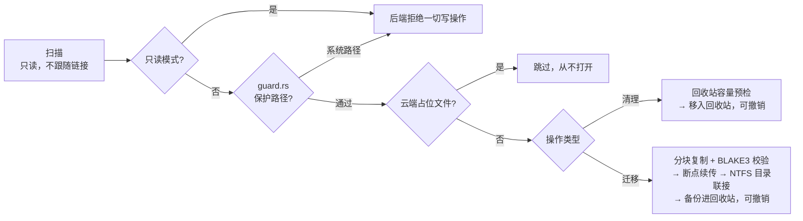
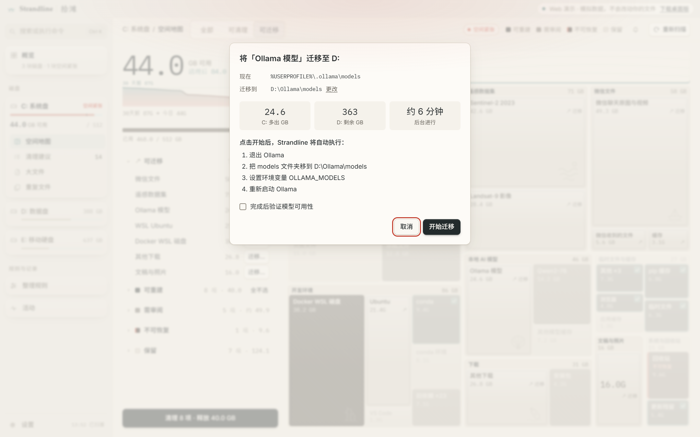
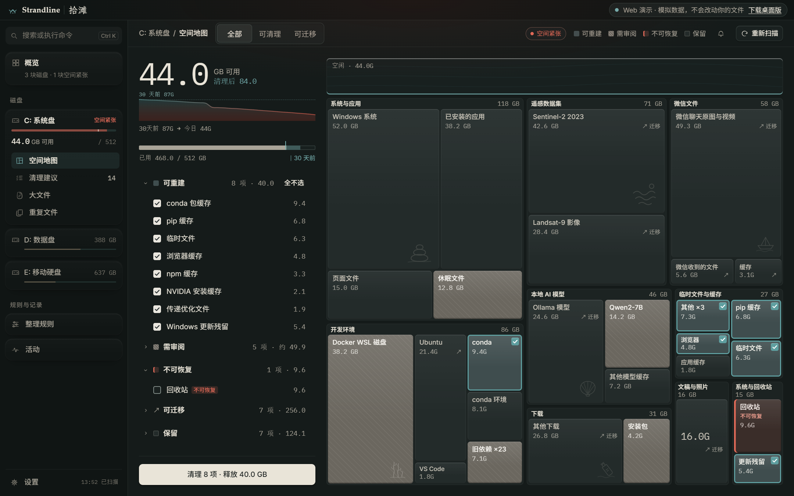
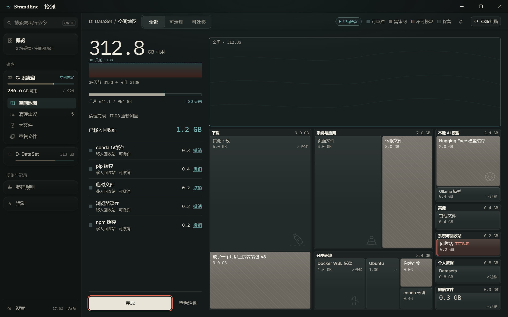

<p align="center"></p>

<h1 align="center">Strandline · 拾滩</h1>

<p align="center">
  <b>安全优先的 Windows 磁盘空间地图与无感迁移工具</b><br>
  先看清空间被谁占了，再决定清什么、搬什么。默认只读，只进回收站，搬走的文件夹原路径照常可用。
</p>

<p align="center">
  <a href="https://qua-drant.github.io/strandline/"></a>
  <a href="https://github.com/Qua-Drant/strandline/actions/workflows/ci.yml"></a>
  <a href="https://github.com/Qua-Drant/strandline/releases"></a>
  
  
  
  <a href="LICENSE"></a>
</p>

<p align="center"><b>简体中文</b> · <a href="README.en.md">English</a> · <a href="SECURITY.md">安全模型</a></p>

> **English summary** — Strandline is a safety-first disk-space map and folder migration tool for Windows (Tauri v2 + Rust + React 19). It starts read-only, only ever moves files to the Recycle Bin, never touches system paths or cloud placeholders, and migrates folders with BLAKE3-verified, resumable copies plus an NTFS junction so the old path keeps working. Full English docs: [README.en.md](README.en.md).

<p align="center">
  
  <br><sub>空间地图 · <b>Web 演示 · 模拟数据</b></sub>
</p>

## 为什么做它

C 盘快满时，常见的磁盘工具给的是一张按文件夹切分的大图，或者一个「一键清理 12 GB」的按钮。用户真正想知道的是：

- **这些空间是谁的？** `AppData\Local\...` 这种路径看不出是微信、Docker 还是模型文件；
- **删了会怎样？** 缓存会自己重建，安装包可以重下，但项目文件、聊天记录删了就没了；
- **不想删，能不能挪？** 很多大目录（微信文件、WSL 磁盘、Ollama 模型）其实只是放错了盘。

Strandline 的做法：

| 用户的担心 | 界面上的回答 |
| --- | --- |
| 看不懂空间分布 | 地图按**用途**分组（系统、开发工具、AI 模型、缓存、个人文件……），可用空间作为一条**真实比例**的潮线画在图里，而不是缩成一个百分比 |
| 不知道能不能删 | 每个区块按清理安全程度着色；每条建议写明它是什么、删了会怎样、等价的 PowerShell 命令 |
| 怕误删 | 默认只读；所有删除只进回收站，30 天内一键撤销；系统路径在后端硬编码拒绝，任何设置都放不开 |
| 删了也省不了多少 | 「迁移」把大目录整体搬到别的盘，原路径用目录联接指过去，程序察觉不到 |
| 不知道空间什么时候被吃掉的 | 90 天「潮汐日历」记录每天的可用空间，配合活动记录追溯 |

## 五重防错



1. **默认只读**：首次启动只扫描；清理、回收、迁移、规则一律被 Rust 后端拒绝，在「设置 › 清理与安全」里手动关闭。
2. **回收站兜底**：所有删除只进回收站。移入前检查该卷回收站的容量上限和「直接删除」设置，放不下就拒绝并说明，不让 Windows 静默永久删除。
3. **系统与云端零触碰**：`src-tauri/src/guard.rs` 硬编码保护 Windows、Program Files、引导/恢复目录、页面文件、注册表配置单元等，解析链接后再查一次；OneDrive / iCloud 仅在线的占位文件从不打开、不计大小、不算哈希、不迁移。
4. **BLAKE3 校验 + 断点续传**：迁移时每个文件分块复制、落盘后读回比对哈希，写断点日志，中断后从断点继续；相关程序正在运行或文件被占用时自动暂停。
5. **NTFS 目录联接无感迁移**：复制校验完成后，原文件夹改名备份，在原处建立目录联接；联接不可达则回滚；备份移入回收站，整个迁移可撤销。

完整说明见 [SECURITY.md](SECURITY.md)。

## 截图

| | |
| --- | --- |
| <br><sub>清理建议 + 90 天潮汐日历 · <b>Web 演示 · 模拟数据</b></sub> | <br><sub>迁移 Ollama 模型到 D 盘 · <b>Web 演示 · 模拟数据</b></sub> |
| <br><sub>概览 · <b>Web 演示 · 模拟数据</b></sub> | <br><sub>空间地图（深色）· <b>Web 演示 · 模拟数据</b></sub> |

<p align="center">
  
  <br><sub>清理回执：1.2 GB 移入回收站，5 项均可撤销 · <b>桌面端 · 沙盒实测</b>（扫描对象是 <code>npm run sandbox</code> 生成的模拟磁盘）</sub>
</p>

## 30 秒上手

**① 直接看在线演示**（零安装，所有数据都是模拟的，随便点）：<https://qua-drant.github.io/strandline/>

**② 本地跑演示版**（需要 Node 22+）：

```powershell
npm install
npm run dev        # http://localhost:5173，浏览器里跑，同样是模拟数据
```

**③ 用桌面版扫描真实磁盘**：从 [Releases](https://github.com/Qua-Drant/strandline/releases) 下载安装包（Windows 10/11，无需管理员权限）。首次启动是只读模式，可以放心扫描 C 盘。

想试清理和迁移又不想碰真实文件？用沙盒：

```powershell
npm run sandbox    # 在 sandbox\demo 生成模拟磁盘（大文件是稀疏文件，几乎不占空间）
npm run desktop    # 需要 Rust（stable-msvc）+ VS C++ 生成工具
```

然后在「设置 › 扫描 › 扫描范围」填 `sandbox\demo` 的完整路径并关闭只读模式，之后所有扫描、清理、撤销、迁移都只发生在这个文件夹里。

## 技术栈与指标

| | |
| --- | --- |
| 桌面端 | Tauri v2 + Rust（并行只读扫描、BLAKE3、`trash`、Win32 文件属性与目录联接） |
| 前端 | React 19 + Vite + TypeScript，桌面端与 Web 演示共用同一套界面 |
| 双模式 | `DiskService` 接口：浏览器里用 `MockDiskService`，桌面端用 `TauriDiskService` 调 Rust 命令 |
| 安装包 | 2–3 MB（NSIS 2.1 MB / MSI 3.1 MB），使用系统自带的 WebView2 |
| 扫描性能 | 30 万文件 / 3100 个文件夹的沙盒：扫描 5.4–7.4 秒（多次实测），峰值工作集约 37 MB；传给界面的地图数据约 17 KB（release 构建，`tests/perf.rs`） |
| 测试 | Rust 26 个（21 单元 + 1 沙盒全流程 + 4 Windows 边界）+ 1 个性能基准；前端 2 个；clippy 警告即失败 |

测试覆盖：沙盒生成；扫描与取消；目录联接环路、硬链接、云端占位文件、无权限文件夹；分类不重复计数；大文件；重复文件（同大小不同内容不会误判）；回收站移入与恢复；沙盒中拒绝清空回收站；迁移校验 + 目录联接、中断续传、程序运行时暂停、撤销；规则预演/执行/撤销；保护路径拦截。**所有测试只在 `sandbox/.tests` 里运行，从不在真实系统盘上做写操作。**

## 开发

需要：Node 22+、Rust（stable-msvc）、Visual Studio C++ 生成工具、WebView2 运行时。

```powershell
npm run lint           # 前端 oxlint
npm test               # 前端测试
npm run build          # 类型检查 + 打包 Web 演示（dist\）
npm run lint:backend   # cargo clippy，警告即失败
npm run test:backend   # Rust 单元 + 集成测试（只在沙盒里）
cargo test --release --manifest-path src-tauri/Cargo.toml --test perf -- --ignored --nocapture   # 30 万文件压测
npm run desktop:build  # NSIS 安装包、MSI 和绿色版 exe
```

开发时可以把应用数据放到别处，避免写入 `%APPDATA%\Strandline`：

```powershell
$env:STRANDLINE_DATA_DIR = "$PWD\sandbox\appdata"; npm run desktop
```

端到端检查：`tools/e2e/cdp.mjs` 通过 WebView2 远程调试驱动真实桌面窗口。

```powershell
$env:WEBVIEW2_ADDITIONAL_BROWSER_ARGUMENTS = "--remote-debugging-port=9222"; npm run desktop
node tools/e2e/cdp.mjs eval "location.hash = '#/map'"
node tools/e2e/cdp.mjs shot map.png 1440x900
```

CI（`.github/workflows/ci.yml`）在 Windows 上跑全部检查并把 Web 演示发布到 GitHub Pages；推送 `v*` 标签时 `release.yml` 构建安装包、绿色版和 `SHA256SUMS.txt` 并创建草稿 Release。

## 目录结构

```
src/                       React 前端
  pages/                   概览、空间地图、清理建议、大文件、重复文件、整理规则、活动、设置
  shell/                   标题栏、侧栏、命令面板、通知、共享状态
  services/diskService.ts  统一接口；mock/（Web 演示）与 tauri/（桌面端）两种实现
src-tauri/src/
  guard.rs                 写入守卫（硬编码保护路径）
  scan.rs  winfs.rs        并行只读扫描、Windows 文件属性
  catalog.rs  finder.rs    分类与建议、大文件与重复文件
  recycle.rs               回收站（容量预检、恢复）
  migrate.rs               校验 + 续传 + 目录联接的迁移
  rules.rs  store.rs       整理规则、本地 JSON 存储
  sandbox.rs               沙盒生成器（bin/sandbox_gen.rs）
src-tauri/tests/           沙盒集成测试、Windows 边界、性能基准
tools/                     端到端脚本、图标
```

## 参与

欢迎 Issue 和 PR，请先读 [SECURITY.md](SECURITY.md)。如果某条清理建议把重要文件标成了「可以清理」，请按安全问题处理，使用 *Cleaning rule false positive* 模板。

## 许可证

[MIT](LICENSE)
